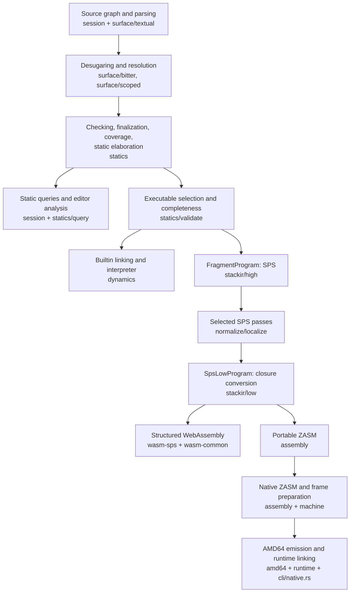

# 01 — Project Map

> Scratch study note for re-onboarding. This chapter orients; the
> [references](../../references/README.md) own every canonical rule and are linked, not restated.

## Snapshot

| Fact | Value |
| --- | --- |
| Revision | Code snapshot documented: `e2dd8979` (`incr: reject non-amd64 native builds before compiling and document amd64 compilation`), 2026-10-30 |
| Working tree | Clean. The short-circuit test/demo and proposal work that was uncommitted during writing landed in `6b0aafcd` |
| Host | arm64 macOS, Rust 1.98.1, Node.js 24.15 |
| CLI | Installed `zydeco` on `PATH` is stale (fails on current `lib/std/builtin.zy`); use `cargo run --quiet --bin zydeco --` or `target/debug/zydeco` |
| Manual home | `docs/logs/re-onboarding/`, temporary scratch under [AGENTS.md](../../../AGENTS.md); committed at `c6c90588`, still not canonical |

The repository is a call-by-push-value (CBPV) language prototype: a source language
with type checking and static elimination, a reference interpreter, a native AMD64 compiler,
a structured WebAssembly backend, a standard library, and editor/REPL tooling.
The project's yardstick is two papers: the OOPSLA relative-monad paper and the stack-passing-style (SPS) paper.
The [artifact boundary memo](../../proposals/artifact-boundary.md#yardstick) distills the resulting obligations
precisely; the [size analysis](../../proposals/artifact-boundary.md#yardstick) applies them to every subsystem.
Keeping this yardstick in view is the difference between "large" and "redundant" when judging code.

## Three Coordinate Systems

The repository is easier to navigate when you keep three numbering systems apart and know how they meet.

| System | Home | What it answers |
| --- | --- | --- |
| Language rules `L1`–`L15` | [language.md](../../references/language.md) | What source programs mean: syntax, typing, evaluation, packages, host boundaries, execution profiles |
| Compiler phases `C1`–`C16` | [compiler.md](../../references/compiler.md) | How the implementation realizes the rules: contracts, representations, algorithms, runtimes, tooling |
| Code | `lang/`, `cli/`, `runtime/`, `editor/` | The concrete modules, types, and functions that carry the phases |

The bridges are explicit:

- [Rule Ownership](../../references/README.md#rule-ownership) maps each source rule to its implementation account.
- [C1 Architecture](../../references/compiler.md#c1-architecture-and-a-programs-path-through-the-compiler)
  maps each phase to the `Program` product it publishes and to its consumer.
- [DESIGN.md](../../../DESIGN.md#implementation-architecture) maps responsibilities to crates
  but restates some reference material; the [reference-drift todo](../../todos/reference-drift.md) tracks
  that duplication.

## A Program's Path

This is [C1's diagram](../../references/compiler.md#c1-architecture-and-a-programs-path-through-the-compiler),
with the crate that owns each step added.

Each arrow crosses a typed product boundary, not just a function call.
Use these products as signposts when reading code:

| Product | Establishing entry point | Consumer | C chapter |
| --- | --- | --- | --- |
| `TextualProgram`, `BitterProgram`, `ScopedProgram` | `lang/session/src/source/pipeline.rs` | Next front-end phase | [C3–C4](../../references/compiler.md#c4-parsing-desugaring-and-name-resolution) |
| `ProgramAnalysis` | `CompilerSession::analyze` | Diagnostics, tooling facts | [C3](../../references/compiler.md#c3-source-loading-sessions-queries-and-memory-retention) |
| `CheckedProgram` | `CompilerSession::checked_program` | Typed-tree inspection | [C5–C6](../../references/compiler.md#c5-typed-representation-judgments-and-inference) |
| `ExecutableProgram` | `CompilerSession::executable_program` | Interpreter linking or SPS lowering | [C1](../../references/compiler.md#c1-architecture-and-a-programs-path-through-the-compiler) |
| `DynamicsProgram` | `lang/dynamics/src/link.rs` | Reference interpreter | [C7](../../references/compiler.md#c7-linking-and-the-reference-interpreter) |
| `FragmentProgram` | `lang/stackir/src/high/lower.rs` | SPS passes, then closure conversion | [C8](../../references/compiler.md#c8-sps-lowering-normalization-and-demand) |
| `SpsLowProgram` | `lang/stackir/src/pipeline.rs` | Wasm or assembly lowering | [C9](../../references/compiler.md#c9-closure-conversion-and-first-order-spslow) |
| `AssemblyProgram` | `lang/assembly/src/pipeline.rs` | ZASM rendering, frame validation | [C10](../../references/compiler.md#c10-zasm-stack-analysis-and-local-representation-choices) |
| `NativeProgram` | `LoweringPipeline::with_native_frames` | AMD64 emitter and linker | [C11](../../references/compiler.md#c11-native-preparation-activation-frames-and-amd64-emission) |

Nine syntax families appear in the pipeline: textual, bitter, scoped, statics,
dynamics, high SPS, SPSLow, ZASM, and AMD64.
Most carry their own identifier, arena, printer, span, and traversal modules;
the [size analysis](../../proposals/artifact-boundary.md#representation-multiplication) counts that support code,
and it is the largest single structural cost in the repository.

## Crate Map

The workspace has 14 crates under `lang/` plus `cli`, `tui`, `editor/cajun`, `xtask`, and the non-workspace `runtime/`.
Dependencies flow down the table.

| Crate | Owns | Depends on (workspace) | Reference |
| --- | --- | --- | --- |
| `lang/utils` | Spans, arenas, the `CompilerPass` framework, fold/graph/context utilities | — | [C1–C2](../../references/compiler.md#c1-architecture-and-a-programs-path-through-the-compiler) |
| `lang/derive` | Proc macros for syntax boilerplate | — | — |
| `lang/syntax` | Shared syntax vocabulary: names, spans, word/primitive/scalar/memory/text bases | derive, machine, utils | [C2](../../references/compiler.md#c2-compiler-data-identities-arenas-and-source-provenance) |
| `lang/machine` | Runtime contracts: word encoding, native boundary, frames, closure and GC metadata; `no_std` | — | [C12](../../references/compiler.md#c12-shared-native-model-allocation-and-collection) |
| `lang/surface` | Textual/bitter/scoped syntax, LALRPOP parser, desugaring, resolution, formatter, metadata catalog | syntax, utils, derive | [C4](../../references/compiler.md#c4-parsing-desugaring-and-name-resolution) |
| `lang/statics` | Typed syntax, bidirectional checker, inference, normalization, static elaboration/elimination, queries, typed arenas | surface, syntax, utils | [C2](../../references/compiler.md#c2-compiler-data-identities-arenas-and-source-provenance), [C5–C6](../../references/compiler.md#c5-typed-representation-judgments-and-inference) |
| `lang/dynamics` | Runtime AST, linker from checked syntax, small-step interpreter, builtin implementations | statics, machine | [C7](../../references/compiler.md#c7-linking-and-the-reference-interpreter) |
| `lang/stackir` | High SPS (`FragmentProgram`), normalization/localization, closure conversion, SPSLow, protocol extraction, SPS checks | statics, surface, syntax, utils | [C8–C9](../../references/compiler.md#c8-sps-lowering-normalization-and-demand) |
| `lang/assembly` | ZASM, stack analysis, representation policies, frame validation | stackir, machine | [C10](../../references/compiler.md#c10-zasm-stack-analysis-and-local-representation-choices) |
| `lang/amd64` | AMD64 emission, SysV boundary, GC/root metadata emission | assembly, machine | [C11](../../references/compiler.md#c11-native-preparation-activation-frames-and-amd64-emission) |
| `lang/wasm-common` | Wasm runtime contract: tagged words, allocator, host-call ABI | syntax | [C13](../../references/compiler.md#c13-webassembly-backend-and-embedding) |
| `lang/wasm-sps` | Structured Wasm emission from SPSLow | stackir, wasm-common | [C13](../../references/compiler.md#c13-webassembly-backend-and-embedding) |
| `lang/session` | Revisioned source inputs, overlays, package discovery, analysis queries, completion/recovery, backend scheduling | every compiler crate | [C3](../../references/compiler.md#c3-source-loading-sessions-queries-and-memory-retention), [C15](../../references/compiler.md#c15-diagnostics-formatting-documentation-and-interactive-tooling) |
| `lang/tests` | Integration harness, source templates, end-to-end macros, typed-arena invariants | cli, session, backend crates | [C16](../../references/compiler.md#c16-validation-debugging-and-extending-the-implementation) |
| `cli` | `zydeco` driver: compile pipeline, diagnostics, execution, native packaging, formatter, Wasm host | workspace compiler crates, tui | [C1](../../references/compiler.md#c1-architecture-and-a-programs-path-through-the-compiler), [C14–C15](../../references/compiler.md#c14-builtin-contracts-primitive-operations-and-foreign-calls) |
| `tui` | Ratatui REPL frontend | session, statics | [C15](../../references/compiler.md#c15-diagnostics-formatting-documentation-and-interactive-tooling) |
| `editor/cajun` | LSP server: diagnostics, hover, completion, rename, formatting, semantic tokens | session, statics, surface | [C15](../../references/compiler.md#c15-diagnostics-formatting-documentation-and-interactive-tooling) |
| `xtask` | Resumable test runner and repository tasks | — | [CONTRIBUTING](../../../CONTRIBUTING.md#run-tests) |
| `runtime/` | Native runtime sources: launcher, allocation, collection, stubs; built per executable | (non-workspace; consumes `zydeco-machine`) | [C12](../../references/compiler.md#c12-shared-native-model-allocation-and-collection) |

`lang/frontend/` exists on disk as an empty directory; it is not a workspace crate.
Do not mistake it for a phase.

## Where the Weight Is

The retired studies measured older revisions.
The table below applies their line accounting to a clean `git archive` of `e2dd8979`; the method
and its limits are recorded in [Where the weight is](../../proposals/artifact-boundary.md#where-the-weight-is).
The study scripts themselves left the tree with their retirement.

| Crate | Production | Test |
| --- | ---: | ---: |
| `statics` | 26,327 | 3,320 |
| `surface` | 15,122 | 8,376 |
| `stackir` | 12,786 | 6,304 |
| `session` | 4,498 | 3,921 |
| `cli` | 3,691 | 6,283 |
| `cajun` | 4,124 | 3,922 |
| `syntax` | 2,930 | 626 |
| `assembly` | 2,789 | 1,555 |
| `dynamics` | 2,778 | 603 |
| `utils` | 2,687 | 1,031 |
| `amd64` | 2,173 | 0 |
| `xtask` | 1,898 | 463 |
| `runtime` | 1,737 | 447 |
| `wasm-sps` | 1,221 | 115 |
| `tui` | 1,140 | 411 |
| `machine` | 1,019 | 280 |
| `wasm-common` | 874 | 0 |
| `derive` | 297 | 171 |
| `tests` | 0 | 7,633 |

Totals: 88,091 production, 45,461 test, 133,552 Rust lines.
Production code lines excluding blanks and comments: 76,775.
The two retired studies agree with this scale but not every number:
the retired cleanup audit measured 123,426 Rust lines at `7e5ee4c1`,
and the retired size analysis measured 93,400 production plus 45,691 test at `6aae43d0`.
Treat all figures as dated snapshots, not invariants.

Outside Rust: 16,326 tracked Markdown lines and 31,647 tracked lines under `docs/evaluations/`
before the two retired studies left the tree (data, scripts, and reports).
The retired size analysis measured 90,248 evaluation lines at `6aae43d0`;
the difference is mostly measurement data removed by later cleanup.

## Documentation Map

| Area | Home | Use it for |
| --- | --- | --- |
| Source-level walkthrough | [tutorial/zydeco-guide.md](../../tutorial/zydeco-guide.md) | First contact with CBPV syntax and idioms |
| Language reference | [references/language.md](../../references/language.md) | Canonical source rules (L1–L15, meta annotations) |
| Compiler reference | [references/compiler.md](../../references/compiler.md) | Canonical phase contracts (C1–C16) |
| Project overview | [DESIGN.md](../../../DESIGN.md) | Orientation, repository map, current limitations |
| Proposals | [proposals/README.md](../../proposals/README.md) | Concrete unfinished designs; not implemented contracts |
| Ideas | [ideas/README.md](../../ideas/README.md) | Open research questions |
| Evaluations | [evaluations/README.md](../../evaluations/README.md) | Dated measurements and their reproduction evidence; retired studies remain in version history |
| Todos | [todos/README.md](../../todos/README.md) | Observed implementation/documentation drift |
| Literate chapters | [docs/spell](../../spell) | Executable narrative from the toplevel language to CPS and call-by-need |
| Style | [docs/style.md](../../style.md) | Naming and composition conventions for source code |
| Legacy | [docs/legacy](../../legacy) | Historical designs; removed syntax, do not copy |

## Navigation Conventions

- **One home per rule.** A rule lives in the reference section that owns its semantic boundary.
  When code and docs disagree, the disagreement belongs in [todos/](../../todos/README.md), not in a second explanation.
- **Product boundaries are the seams.** If you cannot name the input and output product,
  you are probably looking at two phases at once.
- **Source, checked, residual.** "Source" means user syntax; "checked"/"typed" means the statics arena;
  "residual" means what survives static elimination for interpretation or lowering.
- **High/low.** In `stackir`, *high* means lexical SPS and *low* means first-order SPSLow.
  "ZIR" in code and old prose usually refers to the Stack IR family.
- **Runtime metadata vs meta annotations.** Runtime metadata is carried with a runtime value (lengths, vtables).
  Compiler `@[meta]` forms are meta annotations or compile-time metadata.
- **Commands.** From the repository root, `cargo run --quiet --bin zydeco -- <args>`;
  once built, `target/debug/zydeco <args>` is faster.
  The installed `zydeco` may be stale.
- **Anchors.** GitHub-style anchors from headings are stable enough for links;
  `path:line` is a snapshot at `e2dd8979` and drifts with edits.

## Current Working-Tree State

`git status --short` is clean at publication.
While this manual was written, the tree held work that a re-learner should still separate from settled design:

- New proposals: `docs/proposals/constructor-normalization.md`, `join-point-optimization.md`,
  `procedure-environments.md`.
- Modified proposals: `docs/proposals/README.md`, `escape-unboxing.md`, `native-frames.md`.
- New tests and demos: `lang/tests/tests/short_circuit.rs`, `lib/tests/demos/short-circuit.zy`,
  `lib/tests/demos/short-circuit-commuted.zy`.

Those changes landed in `6b0aafcd` (`test: cover runtime short-circuiting and propose compiler improvements`).
Read the new proposals as work in progress.
Settled, implemented design belongs in the references, and moving it there needs the owner's approval
under [AGENTS.md](../../../AGENTS.md).

## Reading Route

1. This chapter, then [02 — Vertical Slice](02-vertical-slice.md) with a terminal open.
2. The six module cards in pipeline order: [front end](cards/01-frontend.md), [statics](cards/02-statics.md),
   [stack IR](cards/03-stackir.md), [native backend](cards/04-native-backend.md),
   [execution backends](cards/05-execution.md), [tooling](cards/06-tooling.md).
3. [03 — Glossary](03-glossary.md) as a lookup, not a read-through.
4. [04 — Cleanup Lens](04-cleanup-lens.md)
   and the [candidate inventory](appendix-cleanup-candidates.md) once the pipeline is familiar.
5. [05 — Question Bank](05-question-bank.md) to test yourself before trusting the map.
