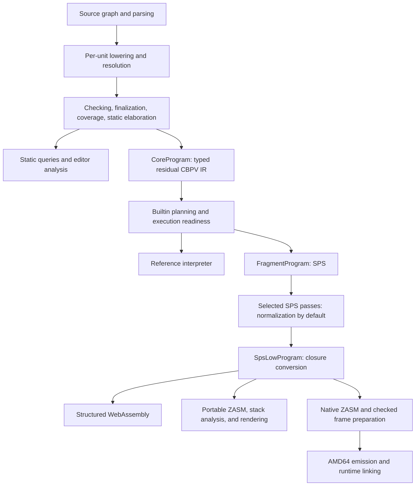

# C1. Architecture and a Program's Path Through the Compiler

[CommandCompiler](../../../../cli/src/compile.rs) adapts the revisioned compiler session to CLI commands and tests.
[CompilerSession](../../../../lang/session/src/source/query.rs) owns source inputs and analysis;
its products distinguish retained analysis facts, a complete checked program, and an executable computation.
The interpreter and every compiled target start from the same checked source and static-elimination boundary.
Compiled targets use stack-passing style (SPS), where arguments, destructor observations,
and return continuations form explicit stacks.



The main boundaries are concrete program types:

| Product | Establishing entry point | Consumer |
| --- | --- | --- |
| `SourceTemplate`, `ResolvedUnitMemo`, `AssembledProgram` | [Per-unit compilation and assembly](../../../../lang/session/src/source/unit.rs) | The next frontend or statics phase |
| `ProgramAnalysis` | `CompilerSession::analyze` | Diagnostics and tooling facts |
| `CheckedProgram` | `CompilerSession::checked_program` | Full typed-tree inspection |
| `CoreProgram` | [Static elaborator](../../../../lang/statics/src/elaborate/static_values/mod.rs) via `StaticsArena::core` | Readiness validation, Builtin planning, interpretation, and SPS lowering |
| `ExecutableProgram` | `CompilerSession::executable_program` | Reference interpreter (`Runtime::new`) or `RootLowerer` |
| `FragmentProgram` | [`RootLowerer`](../../../../lang/stackir/src/high/lower.rs) | Selected SPS transformations, then closure conversion |
| `SpsLowProgram` | [`SpsLowPipeline`](../../../../lang/stackir/src/pipeline.rs) | Structured Wasm or assembly lowering |
| `AssemblyProgram` | [`LoweringPipeline::run`](../../../../lang/assembly/src/pipeline.rs) | ZASM rendering and representation analysis |
| `NativeProgram` | Native pipeline from `LoweringPipeline::with_native_frames` | AMD64 emitter |

Checked-root lowering, SPSLow conversion, and assembly lowering compose through typed compiler passes;
[compiler pass composition](#compiler-pass-composition) below owns their execution and error contract.

Consider this executable, which exits successfully:

```zydeco
param (/Int; /process) : @(import("../../lib/std/builtin.zy")) in
let api = (#run = { fn (n : Int) => ret n }, #spare = 7) in
do code <- ! api/run 0;
! process/exit code
```

Source loading checks the Builtin signature independently.
Checking resolves `api/run` to a structural field route and relates `process` to the executable's type witnesses.
Static elaboration erases static evidence while retaining the explicit thunk and computation calls.
SPS lowering constructs the product and its consuming stack.
Normalization exposes the known field and thunk, binds `n` to `0`, forwards the return
into `code`, and removes unused fields.
Any remaining closure crosses C9 as a closure record with explicit captures.
The selected backend then realizes the remaining host exit; the interpreter executes the checked residual term directly.

A source error stops before that fork.
This term is rejected with `tyck.unconstrained-inference`:

```zydeco
fn x => ret x
```

Its inference region cannot close. The session retains a rejected analysis with diagnostics and available facts;
`CommandCompiler::analyze` reports rejection, and executable selection cannot produce a backend input.
Load, parse, desugar, and resolve failures retain the source information available at their own boundary.

## Compiler Pass Composition

An optimization can expose work for a later pass, and applying a pass again may simplify its result.
Compiler developers need explicit control over order, omission, and repetition when comparing transformations.
The pass scheme gives Rust callers ordinary values and typed interfaces for that control;
CLI plans select built-in transformations within a phase whose required checks and lowering remain fixed.
The same interface composes validation and representation-changing lowerers,
so configurable optimization stages fit into the compiler's existing phase boundaries.

### Typed Passes and Static Composition

The [`CompilerPass<Input>` trait](../../../../lang/foundation/src/pass.rs) exposes each transformation's input,
associated `Output`, and domain `Error`.
A pass value holds configuration and typed dependencies;
`run(&mut self, input)` creates the temporary construction state for that invocation.
Inputs can own a program or borrow one, preserving the existing arena ownership boundaries.
Completed phase arenas need not expose mutable access.
Functions and closures returning `Result` also implement the interface, allowing local checks to participate
without additional named types.

`pipeline![first, second, ...]` constructs a nonempty sequence and connects each output to the next input.
Stage expressions are evaluated once, in declaration order, when the pipeline is constructed.
Execution follows that order and stops at the first error.
A sequence is itself a pass, so named pipelines and nested sequences compose through the same interface.
Rust checks adjacent input and output types; semantic ordering requirements remain the responsibility
of the selected stages and their validated program types.

Stages in a sequence share an error type. `map_err` translates domain errors at a composition boundary;
`with_error` gives an infallible pass the enclosing pipeline's error type.
`run_infallible` removes the unreachable error case when executing an entirely infallible sequence.
For an SPS program `sps`, a Rust caller can select repeated normalization without front-end arenas:

```rust
use zydeco_stackir::{SpsLowPipeline, high::normalize::Normalizer};
use zydeco_foundation::{pass::CompilerPass, pipeline};

let optimizations = pipeline![Normalizer, Normalizer];
let mut lowering = SpsLowPipeline.with_optimizations(optimizations);
let sps_low = lowering.run_infallible(sps);
```

### Runtime Sequences

[`PassSequence<'p, Ir, E>`](../../../../lang/foundation/src/pass/sequence.rs) stores a vector
of configured passes sharing one input/output contract and error type.
Static composition retains concrete pass types; a runtime sequence boxes passes at its storage boundary.
`with_pass` appends an occurrence and retains its position, including duplicates,
so a sequence repeats a pass by appending it again.
An empty sequence and `Identity` return their input.
Configuration is constructed once, while each invocation receives the preceding invocation's output.

The sequence lifetime permits borrowed dependencies without imposing `Clone`, `Send`, or `'static` on every pass.
Failure does not roll back ownership of an input consumed by a pass, and each pass remains responsible
for its temporary construction state.

### Observation and Failures

[`with_observer`](../../../../lang/foundation/src/pass/observe.rs) wraps a pass
with typed before/after hooks for inspection, verification, or rendering.
`PassLocation` identifies its occurrence with a name and structural index path;
the wrapper counts invocations, including reuse across outer executions.
Paths are stored with zero-based indices and displayed with one-based positions.
Observers borrow the program, and timing measures pass execution separately from observer callbacks.
A rejected before hook prevents the pass from running; a rejected after hook prevents downstream execution.
`PassFailure` retains the occurrence and distinguishes the original domain error
from a before/after observation failure.
Panics remain compiler bugs and are not converted into ordinary pass errors.

### Built-In Plans and Phase Boundaries

[`SpsLowPipeline`](../../../../lang/stackir/src/pipeline.rs) declares SPS checks,
optional transformations, and closure conversion as a sequence.
Its `with_optimizations` method accepts any pass preserving `FragmentProgram`,
including `Identity`, a custom Rust pass, or a nested sequence.
The selected stage runs between the required SPS checks and before closure conversion.
The default runs the normalizer once, keeping its combined reductions and demand analysis,
and then [localizes](sps/normalization-and-demand.md#second-class-procedures) the closures that stay shared;
an empty selection still runs the checks and closure conversion.
[SPS](sps.md) defines the representation and normalization rules.

[`SpsPlan`](../../../../lang/stackir/src/passes.rs) describes built-in selection.
`Default` selects `normalize,localize`, `None` selects no optional transformations,
and `Custom` retains an ordered vector of typed `SpsPass` entries.
The textual forms are `default`, `none`, and comma-separated pass names;
the catalog contains `normalize` and `localize`.
An empty textual selection, unknown names or options, empty list entries,
and presets embedded inside lists are rejected before source loading or artifact creation.
Displaying a plan gives its canonical textual selection.
An `SpsSelection` pairs the plan with the [stack-passing scheme](sps.md#correspondence-with-sps)
that lowering uses; its `explain` names the scheme and expands the plan's optional stages together
with their required checking and conversion boundaries.
Rust callers can provide arbitrary `CompilerPass` implementations without joining the built-in catalog.

The command compiler owns the selection and instantiates its passes after checked arenas are available.
An observed plan shares a borrowed observer among distinct occurrences;
each compilation creates fresh invocation counts and temporary pass state.
The SPS observer verifies lexical ownership, the placement rule of the program's scheme,
and root closure using borrowed phase data.
The unobserved default retains static composition.
`BackendProgram` records the selection that produced its frozen SPSLow input,
and its assembly cache belongs to that product.
Selecting another SPS plan or scheme requires a new lowering result, so cached assembly cannot cross selections.
[Assembly representation policy](zasm.md#policy-selection) remains independently selectable and invalidates
that product's assembly cache.

SPS is the configurable optimization boundary.
[`LoweringPipeline`](../../../../lang/assembly/src/pipeline.rs) composes required assembly construction,
stack analysis, and publication from a borrowed SPSLow program.
Its `with_native_frames` option returns a pass that ends in checked `NativeProgram::prepare`,
retaining the distinct portable and native output types and the native frame-planning error.
A future assembly rewrite must execute before the affected analyses,
or explicitly reestablish them before publishing the completed program.
Convergence and shared analysis caching require additional change and invalidation contracts.
Stage scheduling and prerequisite order are explicit in the selected sequence;
source query caching and revision ownership remain with the [session's Salsa database](sessions-and-queries.md).

### Selecting and Inspecting Passes

These commands run from the repository root; [CLI setup](../../../../CONTRIBUTING.md#build-the-cli) explains how
to build or install `zydeco`.
Discover the optional passes and explain their enclosing compiler phase without loading a source:

```sh
zydeco passes
zydeco passes --sps-passes default
zydeco passes --sps-passes normalize,normalize
zydeco passes --sps-passes localize,normalize
zydeco passes --sps-scheme dup
```

Every `build` target accepts `--sps-passes` and `--sps-scheme`.
The source interpreter (`run`), `check`, and the REPL do not execute this backend phase and do not accept the options.
For example, disable optional SPS transformations, select repeated normalization,
or compare how the schemes name stacks:

```sh
zydeco build lib/tests/core/representation-policies.zy --target zir --sps-passes none
zydeco build lib/tests/core/representation-policies.zy --target wasm-sps --sps-passes normalize,normalize
zydeco build lib/tests/core/dispatch.zy --target zir --sps-passes none --sps-scheme dup
zydeco build lib/tests/core/dispatch.zy --target zir --sps-passes none --sps-scheme full
```

Use `--trace-passes` to report occurrences and timings, `--verify-passes` to check SPS invariants before
and after each selected pass, and `--dump-passes` to render the corresponding intermediate programs.
Trace and dump output goes to stderr, leaving the selected target's stdout intact.
With `none`, there are no optional occurrences to inspect; the required phase checks still run.

```sh
zydeco build lib/tests/core/representation-policies.zy --target zir \
  --sps-passes normalize,normalize --trace-passes --verify-passes --dump-passes
```

### Pipeline Examples and Validation

The runnable Rust example [`cli/examples/pipelines.rs`](../../../../cli/examples/pipelines.rs) demonstrates static
and dynamic composition, a custom pass with borrowed configuration, and a timing comparison on the same checked source:

```sh
cargo run --release -p zydeco-cli --example pipelines -- --iterations 30 \
  lib/tests/core/representation-policies.zy lib/tests/core/gc-stress.zy
```

The CSV reports average pipeline construction and normalization times separately,
excluding source checking and SPS construction.
It also records the resulting computation-node count.
Use repeated runs when comparing timings; these measurements do not establish generated-program performance.

Focused checks cover ordering, failure boundaries, CLI selection, and applicable backend execution:

```sh
cargo test -p zydeco-foundation -p zydeco-stackir --lib
cargo test -p zydeco-cli --test passes
```

The `zasm` target renders lowering without executing host effects, while the native
and WebAssembly backends execute them.
Arithmetic operations always lower to typed inline primitives inside their closure bodies, including
under an empty pass selection, as described under [primitive calls](sps/operations-and-patterns.md#primitive-calls).
